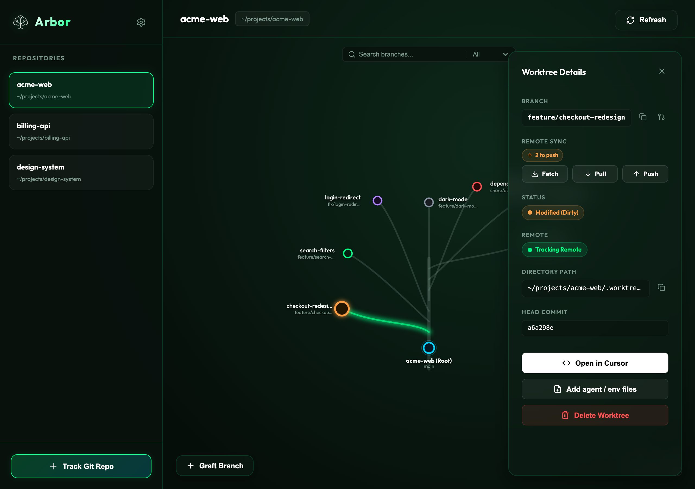
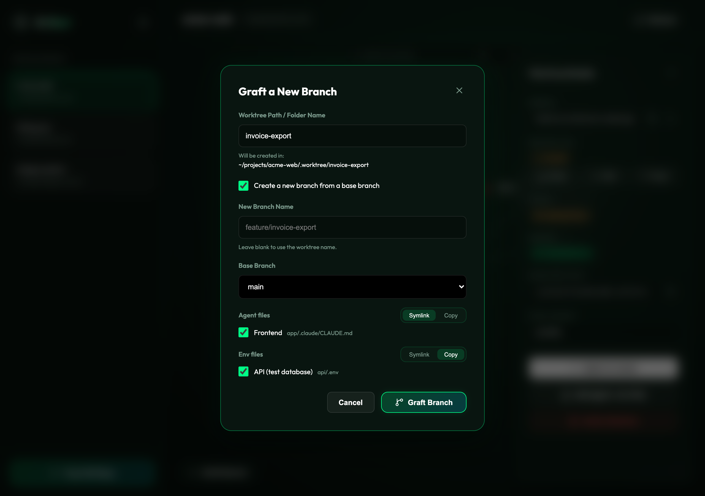
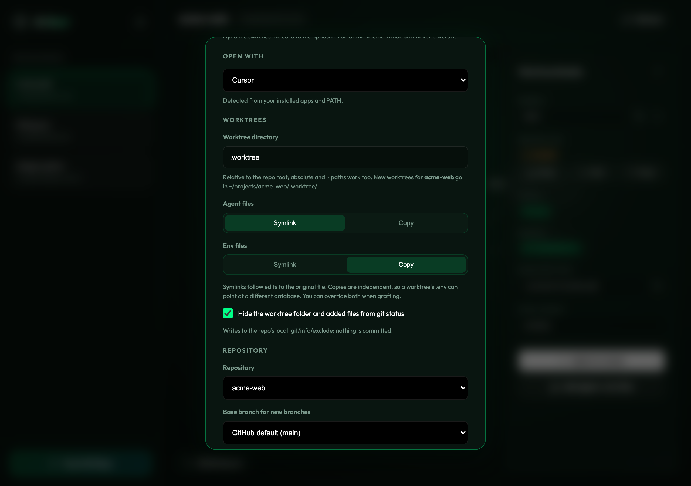
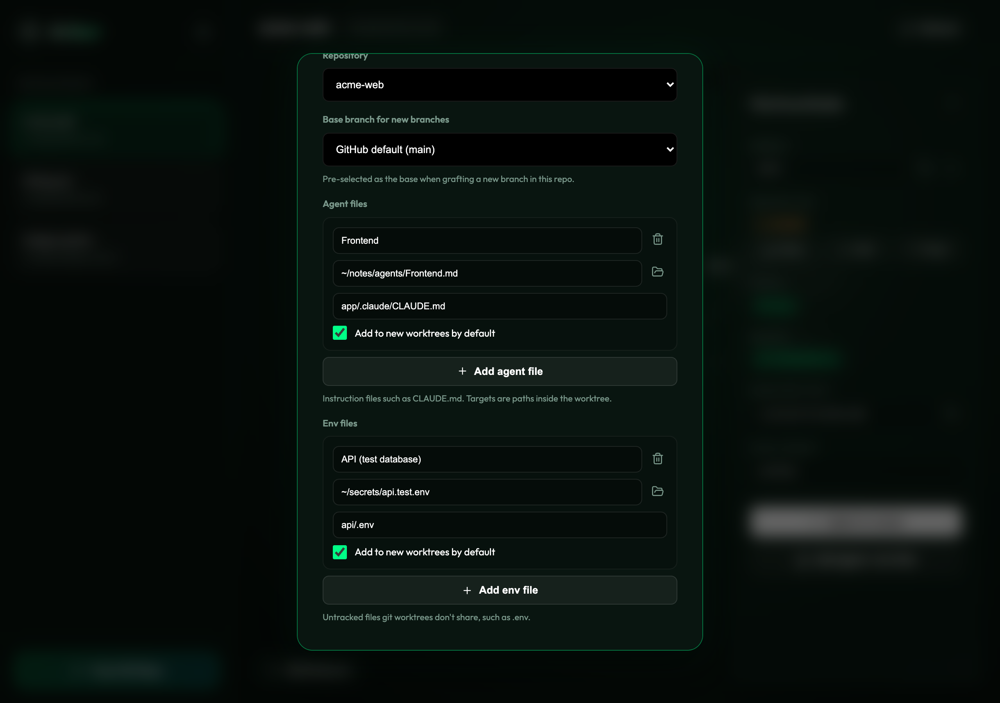
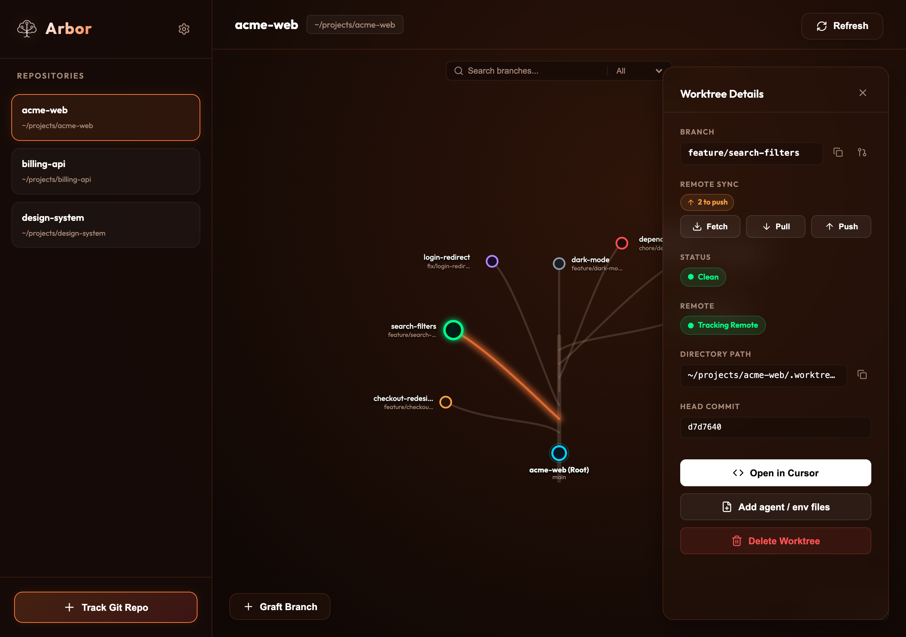

# Arbor

A desktop app for managing git worktrees, drawn as a tree. Your repository is the trunk, every worktree is a branch, and the colour of each node tells you at a glance what needs attention. Built with Tauri 2, React and TypeScript.



## Features

### See every worktree at once

- **Tree view.** The main worktree is the root and every other worktree grows off it. Drag to pan, scroll or pinch to zoom, and use the on-screen controls to zoom or reset.
- **Status at a glance.** Node colour shows the state of the branch. Remote status takes priority over clean/dirty, because a branch with no remote (or a deleted one) matters more than local edits.

  | Colour | Meaning |
  | --- | --- |
  | Green | Clean, tracking a remote |
  | Amber | Uncommitted changes |
  | Grey | No remote branch |
  | Purple | PR merged, but the remote branch wasn't deleted |
  | Red | Remote branch was deleted |

- **Search and filter.** Filter the tree by branch name, or by status (All, Clean, Dirty, Untracked, Merged, Deleted), which is handy for finding worktrees that are ready to clean up.
- **Multiple repositories.** Track as many repos as you like from the sidebar.

### Work with a worktree

Click a node to open its details card:

- Branch name, directory path and HEAD commit, with copy buttons for the branch and path.
- Ahead/behind counts with **Fetch**, **Pull** and **Push** buttons.
- A link to the branch's GitHub pull request, if there is one.
- **Open in** your editor of choice (see [Open with](#open-with)).
- **Add agent / env files** to the worktree after the fact.
- **Delete Worktree**, with a confirmation and an explicit force option for worktrees with uncommitted changes.

### Graft a new branch

The **Graft Branch** button creates a worktree for a new or existing branch.



- Type a worktree name and the branch name placeholder follows it: `invoice-export` suggests `feature/invoice-export`. Leave the branch field blank to use the suggestion, or type your own.
- The dialog previews exactly where the worktree will be created.
- The base branch is pre-selected from your per-repo setting, falling back to the repository's default branch on GitHub.
- Pick which [agent and env files](#agent-and-env-files) to add, and whether each kind is symlinked or copied for this one worktree.

### Agent and env files

Git worktrees don't share untracked files, so every new worktree normally starts without your `.env` or your `CLAUDE.md`. Arbor can add them for you.

For each repository you register **agent files** (instruction files such as `CLAUDE.md`) and **env files** (such as `.env`). Each entry has:

- a **source** file, for example a note in your Obsidian vault or a `.env.test` kept outside the repo
- a **target** path inside the worktree, for example `app/.claude/CLAUDE.md` or `api/.env`
- an **add to new worktrees by default** checkbox

Agent files and env files have **separate link modes**. Symlinks follow edits to the original, which suits shared agent notes. Copies are independent, so you can point one worktree's `.env` at a different database without touching the original. By default agents are symlinked and envs are copied, and you can override either when grafting.

A few safeguards are built in:

- Existing files at the target are replaced, and Arbor never writes *through* an existing symlink, so switching a worktree between symlink and copy can't overwrite your source file.
- Targets must be relative paths inside the worktree. `../x` and absolute paths are rejected.
- Files already tracked by git are skipped rather than overwritten.
- If a file can't be added, the worktree is still created and you get a short report of what was skipped and why.
- Optionally, the worktree folder and the added files are hidden from `git status` through the repo's local `.git/info/exclude`. Nothing is committed.

### Open with

Arbor detects the editors installed on your machine and lets you choose which one the details card opens. It looks at installed apps (macOS) and your `PATH`, and recognises VS Code (and Insiders), VSCodium, Cursor, Windsurf, Zed, Sublime Text, Visual Studio (Windows), WebStorm, IntelliJ IDEA, PyCharm, RustRover, Android Studio, Xcode and Nova. Only the ones you have appear in the list.

### Settings



| Setting | What it does |
| --- | --- |
| Theme | Six themes (Forest, Spring, Summer, Autumn, Winter, Cherry Blossom), or follow the seasons. The app icon follows the theme. |
| Tree | Whether nodes are labelled by worktree name or branch name, and which side the details card opens on. |
| Open with | The editor used by **Open in**. |
| Worktree directory | Where new worktrees are created. Relative paths live inside the repo root (default `.worktree`); absolute and `~` paths also work. |
| Agent / env link mode | Symlink or copy, set separately for each kind. |
| Hide from git status | Adds the worktree folder and added files to `.git/info/exclude`. |
| Repository | Per repo: the base branch for new branches (default: GitHub's default branch), and its agent and env files. |





## Requirements

- [git](https://git-scm.com/)
- The [GitHub CLI](https://cli.github.com/) (`gh`), signed in, is optional. It powers pull request links, merged-branch detection and the GitHub default branch. Without it those features quietly turn off.

## Install

Download the latest build for your platform from the [Releases](https://github.com/taskinoz/Arbor/releases) page, or build it yourself below.

## Development

You'll need Node.js 20.19+, a Rust toolchain, and the [Tauri prerequisites](https://v2.tauri.app/start/prerequisites/) for your OS.

```bash
npm install
npm run tauri dev      # run the app with hot reload
```

```bash
npm run tauri build    # production bundle for your platform
npm run build:install  # macOS: build and install Arbor.app into ~/Applications
```

Type-check the frontend and run the Rust tests:

```bash
npx tsc --noEmit
cd src-tauri && cargo test
```

### Releases

Pushing a tag that starts with `v` (for example `v0.4.0`) runs the release workflow, which builds macOS (Apple Silicon and Intel), Linux and Windows bundles and attaches them to a draft GitHub release.

### Where things live

| Path | Contents |
| --- | --- |
| `src/` | React frontend: tree canvas, sidebar, details card, graft and settings dialogs |
| `src-tauri/src/lib.rs` | Git and GitHub commands exposed to the frontend |
| `src-tauri/src/files.rs` | Linking and copying agent/env files, with tests |
| `src-tauri/src/editors.rs` | Editor detection and launching |

Your tracked repositories are stored in the app's config directory (on macOS, `~/Library/Application Support/com.arbor.app/`). Settings, including per-repo files, are stored in the app's local storage.

## Platform notes

Arbor is developed and tested mainly on macOS. On Windows, creating symlinks requires Developer Mode, so use the Copy link mode if you haven't enabled it. Visual Studio detection is Windows-only.

## Related

[`wt`](https://github.com/taskinoz/wt) is a small command-line companion that creates worktrees with the same idea of adding agent and env files, for when you'd rather stay in the terminal.
